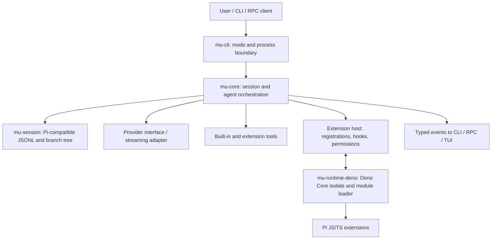

# RFD0001 - Mu Rust Port and Deno Extension Runtime

- Feature Name: `mu-rust-port`
- Status: Accepted
- Author: Project maintainers
- Start Date: 2026-10-16
- Updated: 2026-10-16
- Discussion PR: Not created
- Tracking Issue: Not created

## Summary

This RFD records the decision to build Mu as a drop-in Rust implementation of Pi's coding-agent core, with Deno Core embedded as the JavaScript execution engine for Pi-compatible extensions. Mu will implement its Pi-shaped agent/session lifecycle, provider and tool orchestration, persistence, CLI modes, and extension host contract directly in this repository; it will not depend on the sibling `agents` crate to define or run that core. JavaScript/TypeScript extensions run inside an embedded runtime and communicate with Rust through a deliberate host API rather than reaching into Rust internals. Mu must read and write Pi's existing persisted data model and file formats directly, so Pi and Mu can use the same sessions without a lossy conversion step. Compatibility is defined by observable Pi behavior and a versioned extension API, exercised against upstream fixtures—not by claiming that every arbitrary Node.js plugin works without qualification. The workspace is in early implementation. `mu-session` currently parses/serializes session JSONL, retains unknown fields, and ports Pi's v1/v2-to-v3 migrations; full typed messages, tree operations, and file persistence remain outstanding.

## Motivation

Pi's value is not only its model loop. Its coding-agent package composes session persistence, model streaming, tools, context construction, extension hooks, retries, compaction, and multiple run modes. Extensions can register tools, commands, providers, event handlers, UI behavior, and session state. Translating only the loop would lose much of what makes Pi useful and would make existing extensions unusable.

Mu needs a clear division of responsibility before porting these behaviors. It is intended as a drop-in replacement, not just an implementation that can import Pi data once. Mu must share Pi's persisted session data model and file formats so existing Pi sessions remain readable and new Mu sessions remain readable by Pi. In particular, Deno Core embeds V8 but does not provide the complete Deno CLI: Mu must supply module loading, TypeScript transpilation, package resolution, permissions, host APIs, and lifecycle behavior. Treating these as implementation details would create an accidental, underspecified plugin system.

This proposal uses the current upstream Pi source pinned at `reference/pi` as the behavioral reference. Important entry points include `packages/coding-agent/src/core/agent-session.ts`, `session-manager.ts`, `extensions/types.ts`, `extensions/runner.ts`, `packages/ai/src/types.ts`, `packages/agent/src/types.ts`, and `packages/coding-agent/docs/{session-format,message-types,extensions}.md`. The reference commit recorded during bootstrap is `698a2d23b86a5045dd54554354a5e0cb7e466795`; it must be advanced intentionally as compatibility work proceeds.

## Goals

- Implement Pi's coding-agent core directly in Rust while retaining Pi's session, tool, provider, and extension contracts.
- Keep existing Pi extension code loadable through an embedded Deno Core runtime and a compatibility host API.
- Keep JavaScript execution behind a runtime boundary so core agent behavior can be tested without V8.
- Preserve Pi's persisted data model and file formats exactly: Mu must read and write the same session data Pi reads and writes, without lossy translation, while safely round-tripping entries Mu does not yet understand.
- Build a substantial deterministic end-to-end suite using fake providers and real extension fixtures.
- Make compatibility gaps explicit, observable, and testable.

## Non-goals

- Reimplement every package in the Pi monorepo or every terminal feature in the first milestone.
- Guarantee compatibility with arbitrary Node.js applications, native Node addons, every npm package, or extensions that depend on undocumented Pi internals.
- Replace Deno Core with a separate JS engine.
- Add sub-agents, planning mode, or other agent features Pi intentionally omits unless proposed separately.
- Use model quality evaluations as a substitute for deterministic correctness tests.
- Depend on the sibling `agents` crate for Mu's core loop, canonical message/context model, session persistence, or extension semantics. Mu's Pi-compatible contracts are authoritative.

## Guide-level explanation

A user starts Mu from a working directory. Mu loads settings and resources, creates a session, and starts the selected interface (initially a CLI mode). The Rust core constructs a model request from the active session branch, prompt, and tool set. Provider output is consumed as a stream. Text and tool-call events become typed Rust events; tool calls are checked, passed through extension hooks, executed, and recorded. The agent continues until it has a final answer, the operation is aborted, or a bounded retry/compaction path takes over.

Extensions remain JavaScript/TypeScript modules. At session startup, Mu discovers extension entry points and evaluates them in an embedded runtime. They receive a Pi-shaped `ExtensionAPI` implemented by Mu's host bridge. For example, a plugin can register a tool or listen for `session_start`; Rust remains the authority that validates and executes tool calls and persists messages. Extension code can request supported host actions through asynchronous runtime operations, but it does not receive a raw pointer to Rust state or unrestricted access to implementation internals.

The practical plugin promise is: extensions using the documented Pi API and supported module/runtime capabilities should either behave compatibly or fail with a clear diagnostic that names the unsupported capability. “It loaded without a syntax error” is not the compatibility bar.

### Example

Given a Pi extension that registers a tool and observes tool results:

1. Mu's resource loader finds its entry file and resolves its imports according to the supported compatibility profile.
2. Mu transpiles TypeScript if needed and evaluates the module in the session's extension runtime.
3. The extension calls `pi.registerTool(...)`; the JS host binding parses the tool declaration and sends a registration to Rust.
4. Rust validates the name and schema, stores the handler identity, and exposes the tool declaration to the model.
5. On a model tool call, Rust validates arguments, invokes the ordered `tool_call` hooks, then calls the matching extension handler through the runtime bridge.
6. Rust validates and records the returned tool result, invokes `tool_result` hooks, and streams the resulting event to the CLI.
7. On shutdown or extension reload, Mu cancels/finishes active work according to the lifecycle contract, runs cleanup handlers, and disposes or recreates runtime state.

If the extension imports an unsupported Node native addon, Mu should report that unsupported import rather than silently supplying a partial fake implementation.

### Diagram



## Reference-level explanation

### Architecture and boundaries

The proposed dependency direction is inward: interfaces and domain rules are independent of terminal and JavaScript runtime choices. Outer crates implement those interfaces.

- **`mu-core`** owns the turn state machine, typed agent events, tool orchestration, prompt/context assembly, retries and compaction policy, and session-facing abstractions. It must not depend on Deno, a concrete terminal, or a concrete provider.
- **`mu-session`** owns Pi's exact session entry/message model, append-only JSONL codec, parent/leaf relationships, active branch projection, and the same default session paths. Rust types may be idiomatic internally, but serialization must preserve Pi's field names, enum tags, optional fields, timestamps, and extension-defined data. Preserve unknown entry payloads rather than discarding data during read/write.
- **Provider boundary** is a typed streaming request/response interface. Provider adapters translate wire formats into Mu's normalized message/event model. Keep the initial provider code in core modules or a separate `mu-ai` crate only when a stable boundary is clear; do not force a crate split solely to mirror Pi's package names.
- **Extension host** owns the Pi-facing API contract, registrations, event ordering, schema validation, capability checks, diagnostics, and lifecycle. This is logically distinct from the JS engine: Rust should be able to test the API contract with a fake runtime.
- **`mu-runtime-deno`** embeds Deno Core and implements extension source loading/evaluation, JS↔Rust calls, runtime error translation, cancellation, and isolate disposal. It is an adapter behind the extension host boundary, not the place where agent semantics live.
- **`mu-cli`** parses arguments, selects a run mode, assembles services, and handles process I/O. TUI, RPC, and non-interactive modes should share the same session and agent core; a TUI crate is a later extraction, not a prerequisite to correctness.
- **`mu-e2e`** holds deterministic fixtures and test support. It may be a support crate plus integration-test directories; keep the tests themselves close to the workflows they exercise.

The initial workspace names `mu-core`, `mu-session`, `mu-runtime-deno`, `mu-cli`, and `mu-e2e` are scaffolding for these boundaries, not proof that all domain responsibilities have already been assigned to code. `mu-session` is the first concrete compatibility slice: it parses and serializes session JSONL records, preserves unrecognized fields, and implements the v1/v2-to-v3 schema migrations. Full typed message modeling, tree operations, and file persistence are still to be implemented. Mu's core will be designed against Pi's contracts first. If implementation reveals reusable generic agent abstractions, those can later be upstreamed into the sibling `agents` crate without making Mu depend on that crate.

### Data model and interfaces

#### Agent loop

Represent a run as an explicit state machine rather than a single large async function with implicit flags. At minimum, model: input accepted, request prepared, provider streaming, tool execution, continuation decision, final/aborted/failed. Preserve observable event ordering and usage aggregation. Cancellation must flow from the initiating CLI/session operation through provider streams, tool execution, extension handlers, and nested work.

Provider interface concept (illustrative; names are not yet a committed Rust API):

```rust,ignore
trait Provider {
    async fn stream(&self, request: ModelRequest, cancel: CancellationToken)
        -> Result<ModelEventStream, ProviderError>;
}
```

The normalized stream must represent text/thinking deltas, tool calls, usage, completion, and provider errors without leaking a provider-specific SDK into `mu-core`.

#### Sessions

Pi's persisted session data model and file formats are a hard compatibility contract, not a best-effort import/export feature. Mu reads and writes the same JSONL representation, entry types, field names, IDs, parent links, timestamps, and branch-selection semantics Pi uses. This includes the session header and its version, message entries carrying Pi's `AgentMessage` union (system, user, assistant, toolResult, bashExecution, custom, branchSummary, and compactionSummary), and non-message entries such as model/thinking changes, usage, compaction, context edits, branch summaries, extension custom state/messages, labels, and session info. Content blocks, provider metadata, usage/cost fields, tool details, and extension payloads must retain the Pi schema. The exact entry inventory follows the pinned upstream revision and is updated with the conformance fixtures.

A session is an append-oriented sequence/tree of entries with stable IDs and parent links; the selected leaf defines the active transcript. Branching changes the selected leaf rather than erasing abandoned history. Store finalized agent/tool messages and relevant state changes before exposing a completed turn to callers. Use Pi's default session location and directory grouping (`~/.pi/agent/sessions/--<path>--/<timestamp>_<session-id>.jsonl`, subject to Pi's configured data root) so the user does not need to import or copy session files to switch between Pi and Mu.

Mu writes changes in a form Pi can read, and Pi-written sessions remain usable in Mu. Preserve unknown or future entry payloads losslessly during read/write; do not drop, normalize away, or rewrite fields Mu does not interpret. Preserve semantic JSON data, not necessarily insignificant byte details such as object-key order or whitespace. Match Pi's version handling: read legacy session versions and apply compatible upgrade behavior (the pinned reference documents v1 linear sessions, v2 tree sessions, and v3's `hookMessage` to `custom` role rename), then write the current version used by the pinned Pi revision (v3 at the recorded reference). Compatibility fixtures must verify both directions (Pi fixture -> Mu operation -> Pi-readable output), not merely successful deserialization. Do not introduce a Mu-only session format as a shortcut.

#### Extension host contract

The extension API is a documented host interface, not direct access to internals. Rust validates registrations and calls; JavaScript gets only supported operations through host bindings. The host contract should specify:

- Registration names, schemas, duplicate handling, and load order.
- Which events are notifications, which transform/cancel operations, and how handler results compose.
- Handler ordering, timeout/cancellation behavior, and error policy.
- Tool execution inputs/results, structured content, usage, and nested-call behavior.
- Session and command contexts, UI capability availability by mode, and persistence APIs.
- Session startup, shutdown, reload, and runtime invalidation behavior.
- Compatibility/version signaling for APIs that cannot be reproduced exactly.

The host API should map documented Pi API contracts first. Internal host operations should be narrow and typed. A plugin's tool schema and returned values are untrusted input at the Rust boundary and must be parsed before they become trusted domain values.

#### Deno module loading and TypeScript

Deno Core supplies V8/runtime primitives, not the complete Deno CLI stack. `mu-runtime-deno` therefore needs explicit components for:

1. Resource discovery and canonicalization of entry paths.
2. A module loader for relative/file imports and a defined strategy for package imports.
3. TypeScript/JSX transformation if TypeScript extensions are in scope.
4. Host operations and selected web/Node-like globals needed by supported plugins.
5. Permission mediation for filesystem, process, network, and environment access.
6. Structured diagnostics with source locations and extension identity.

The proposed compatibility profile is incremental but contract-driven: built-in language/module semantics and documented Pi API first, then dependency resolution and commonly used runtime APIs selected from real extension fixtures. Use Deno's Rust ecosystem components where their APIs support embedding; do not assume that using Deno Core automatically provides npm support or Node compatibility. The exact resolver/transpiler crate selection is an implementation-time decision to validate before promising broad TypeScript/npm compatibility.

### Lifecycle and failure semantics

A session owns its extension registrations and runtime. During load, Mu discovers extension resources, creates the runtime, evaluates modules in deterministic order, and awaits each extension factory as Pi does. If an extension fails to load, report its identity and error and follow a documented policy; the default proposal is to isolate the failed extension and continue loading others, unless a required core registration makes the session unsafe to start.

During a run, extension handlers execute according to their documented order and are awaited where their result affects behavior. Failures should be surfaced with event/tool context. A failed authorization/pre-tool hook fails closed for the affected tool call; a notification-only hook failure is reported but does not rewrite the model response. The exact behavior must match the corresponding Pi contract where documented.

On abort, Mu propagates cancellation, prevents stale extension contexts from mutating a replaced session, and waits for bounded cleanup. On shutdown/reload, cleanup is idempotent. Runtime crashes must not corrupt persisted session state: commit entries at defined boundaries and make runtime replacement recoverable. Timeouts and hard interruption policy need an implementation decision that accounts for V8 isolate behavior; cancellation alone cannot be assumed to stop synchronous infinite JavaScript.

Provider errors, tool errors, extension errors, and persistence errors are distinct typed failures. Retriable provider errors may follow bounded retry policy; malformed extension output is not a provider retry. Never silently drop a tool call or session entry after reporting success.

### Invariants

- Rust is authoritative for session state, tool validation/execution decisions, and capability checks.
- Model-provider implementations and the Deno runtime are replaceable adapters behind stable typed interfaces.
- No live provider credentials are required for ordinary unit or end-to-end tests.
- A successful tool call has a validated input and a recorded result; failure is represented explicitly.
- Session branching preserves abandoned branches and selected-leaf semantics.
- Session persistence uses Pi's exact data model and serialized format in both directions; no lossy Mu-only conversion is permitted.
- Extension execution is ordered where order affects behavior, and concurrency is explicit where it does not.
- A plugin cannot gain host capabilities merely by constructing arbitrary JS values; host calls validate identity, arguments, and permissions.
- Unsupported extension features produce actionable diagnostics and do not masquerade as successful no-ops.
- Runtime cancellation, reload, and shutdown invalidate session-bound contexts and clean resources idempotently.
- Core agent/session tests can run without initializing V8.

### Compatibility and migration

There is no existing Mu user data to migrate at this stage. Pi compatibility must cover both source-level extension interactions and persisted session data. The persisted data model is not translated into a Mu-specific format: Pi and Mu must operate on the same representation. Mu should use Pi's default agent-data root and session path convention rather than creating a parallel `~/.mu` session store; settings and other shared resource locations should follow Pi's discovery rules as their contracts are inventoried.

Compatibility should be measured in at least three layers:

1. **Format compatibility:** read, project, append, branch, and write Pi session fixtures in the same Pi JSONL format, with Mu output remaining readable by Pi and unknown entries preserved losslessly.
2. **API compatibility:** run documented extension API fixtures against Mu and compare registrations, hook order, tool behavior, results, lifecycle, and errors.
3. **Runtime compatibility:** load representative JS/TS modules and package dependencies from a documented compatibility matrix.

The phrase “Pi plugin compatibility” must name the supported API/version and module/runtime profile. Arbitrary plugins may rely on Node internals or undocumented behavior and cannot be guaranteed without corresponding APIs. Do not advertise full compatibility based only on a smoke test that evaluates one JavaScript string.

### Security, privacy, and observability

Pi extensions can execute code with powerful process permissions. Embedding the runtime does not automatically make plugins safe. Mu must define whether plugins run with host-equivalent permissions or behind explicit capabilities. The proposal favors explicit host-mediated access for Mu-owned APIs but recognizes that filesystem/process access may be required by existing extensions; this tradeoff must be resolved before broad compatibility claims.

Never expose API keys or session internals to extensions unless the matching Pi API explicitly provides them. Avoid logging prompts, credentials, tool results, or source contents by default. Emit structured diagnostics with session ID, extension identity, event/tool name, duration, and failure category while redacting sensitive values. Permission denials and compatibility gaps should be observable.

A truly isolated plugin may need its own process because a V8 isolate inside the Mu process is not a security boundary against all native/runtime vulnerabilities. Process isolation is not part of this first architecture proposal but remains a possible hardening path.

### Rollout and validation

Implement and validate in vertical slices:

1. **Behavior inventory:** pin upstream revision; write contract tables for agent loop, session JSONL, tool semantics, extension lifecycle, and CLI modes.
2. **Pi session data boundary:** (started) finish the typed session/message model, tree operations, file persistence, and broader upstream fixture tests. The initial JSONL record codec, unknown-field retention, and v1/v2-to-v3 migrations are implemented.
3. **Deterministic agent loop:** fake provider stream, built-in tool boundary, event ordering, cancellation, retry, and transcript tests without V8.
4. **Extension contract without Deno:** fake extension host to test registrations, hook ordering/composition, validation, errors, and lifecycle.
5. **Deno bridge:** evaluate and import JS/TS modules; implement the first documented Pi extension API subset; run real extension fixtures through host operations.
6. **End-to-end CLI:** prompt -> provider -> tool/extension -> persisted transcript -> resume; cover abort/error/reload paths.
7. **Compatibility expansion:** add APIs and resolver capabilities based on the conformance matrix; keep unsupported cases documented.

Required CI should be deterministic and offline. It should include unit tests, JSONL golden tests, extension contract tests, and end-to-end workflows with a fake provider. Live-provider evaluations are optional and separately gated. These tests exercise Mu's own Pi-compatible implementation; they must not require the `agents` crate or use another crate's abstractions as the compatibility oracle.

Acceptance for the first useful milestone requires: a deterministic agent turn, tool-call round trip, bidirectional Pi session-format compatibility (Mu can continue a Pi-created session and Pi can read a Mu-updated session), and at least one real Pi-style JS extension registering and executing a tool through Deno Core. Compatibility tests must compare serialized data and branch behavior, not only deserialized values. Broader compatibility requires a published feature matrix and passing fixtures for each claimed feature.

## Drawbacks

- Maintaining a Rust host and a JS extension API introduces a cross-language boundary with schema conversion, async dispatch, error mapping, and lifecycle complexity.
- Reproducing Pi semantics while using Deno Core without the full Deno CLI may require maintaining custom module-loading and runtime integrations.
- Preserving Pi's session format constrains Rust-side data model evolution and requires careful forward-compatibility handling.
- Strong sandboxing and broad legacy plugin compatibility can conflict; APIs that expose filesystem/process capabilities weaken isolation.
- The proposed layers add abstractions before the Rust implementation has proven which boundaries are stable.
- A large compatibility test corpus takes time to build and maintain, especially as upstream Pi evolves.

## Rationale and alternatives

### Proposed design

The Rust core should own behavior and durable state; JavaScript remains a compatibility surface hosted by Deno Core. This keeps the new implementation's invariants and testability in Rust while preserving extension investment. A fake runtime boundary allows most correctness tests to stay fast and deterministic. A pinned upstream reference plus executable fixtures makes the port auditable rather than relying on memory or prose alone.

The current crate choices express dependency boundaries, not one crate per upstream package. This deliberately avoids importing Pi's package topology as if it automatically suited Rust. `mu-core`, `mu-session`, `mu-runtime-deno`, `mu-cli`, and `mu-e2e` are the initial workspace; add provider, extension API, or TUI crates only when their public ownership and dependency boundaries justify them.

### Simpler or narrower approach

A Rust agent loop with no extension compatibility would be substantially simpler and could reuse existing JS plugins only through a separate Node subprocess. It would not satisfy the requirement that plugins load through embedded Deno Core. Conversely, an embedded Deno runtime that only evaluates JS source but has no API bridge is a useful prototype, not a product architecture; it leaves real extensions unable to participate in the agent.

### Other alternatives considered

- **Keep Pi in TypeScript and wrap it with a Rust executable:** maximizes compatibility but does not port the core to Rust and retains Node as the application runtime.
- **Run extensions in an external Node process:** provides mature Node module behavior and stronger process isolation options, but violates the embedded Deno Core constraint and adds IPC/lifecycle complexity.
- **Use Deno CLI/runtime wholesale:** might provide more ready-made module and permission support, but is broader than the requested Deno Core embedding and could impose substantially more runtime surface. Revisit if custom loaders prove too costly.
- **Port only Pi's generic agent loop:** smaller initial effort, but omits sessions, extension lifecycle, resources, and user-facing workflows that are central to Pi.
- **Build Mu directly on the sibling `agents` crate:** would reuse generic agent and provider abstractions, but would make Mu adapt Pi's streaming, session, and extension contracts to a separate core model. This risks lossy conversions and couples Mu's compatibility to the sibling crate's release and design choices. Instead, implement against Pi first; upstream only abstractions that prove reusable afterward.
- **Reimplement every Pi package as a matching Rust crate:** creates premature package/API boundaries. Split only when Rust dependency direction and reuse justify it.

### Do nothing

Without an agreed architecture, early implementation is likely to couple agent state to V8 or CLI types, invent incompatible session storage, or claim extension support based on trivial scripts. Correcting these choices after implementing tools and UI would be expensive. Doing nothing preserves the empty bootstrap but provides no usable Mu.

## Prior art

- **Pi upstream:** `reference/pi` contains the source of truth for observed behavior. Its coding-agent session object composes agent loop, extensions, tools, compaction, persistence, and run modes; the Rust port should preserve those seams where they express real contracts, not mechanically reproduce TypeScript class structure.
- **Deno Core:** embeds V8 and exposes low-level runtime primitives. Lesson: embedding a JS engine is only one layer of plugin compatibility; loading, transpilation, permissions, and host APIs remain application responsibilities.
- **Sibling `agents` crate:** a Rust agent framework also owned and maintained by this project, with provider, tool, session-agent, and event abstractions. Mu is not a consumer of that framework: it will first serve as a concrete Pi-compatibility implementation. If Mu develops generic abstractions that fit `agents`, those learnings may be upstreamed later. Reuse should follow demonstrated compatibility, not drive Mu's core design.

## Unresolved questions

### Before broad compatibility claims

- What does “all plugins” mean for the initial compatibility promise: documented Pi ExtensionAPI only, common npm dependencies and Node built-ins too, or a broader Node-compatible target?
- Should plugins inherit Mu process permissions for maximum compatibility, or should filesystem/process/network access be capability-gated even when that requires migration or incompatibility?
- Which non-session Pi persistence formats (for example settings, model catalog, and auth storage) can Mu safely share directly, and which need a compatibility adapter or security review? The session JSONL model and default session paths are not optional.
- Does one runtime/isolate host all extensions in a session, or does each extension get a separate isolate? Shared module state favors closer Node-like behavior; separate isolates improve fault isolation but complicate extension interactions and compatibility.

### During implementation

- Which Deno ecosystem crates provide suitable embeddable TypeScript transpilation and package resolution for the pinned Deno Core version?
- Which provider/model APIs are needed for the first end-to-end milestone?
- Which extensions should form the representative compatibility corpus?
- At what point do session persistence, provider adapters, extension host APIs, or TUI justify separate workspace crates?

### Out of scope

- Plugin marketplace/package installation and trust UX.
- Multi-process plugin isolation and resource quotas.
- New Mu-only agent features not needed for Pi compatibility.
- Cross-session collaboration and distributed session storage.

## Future possibilities

After the compatibility baseline stabilizes, Mu could expose a stable Rust embedding API, support remote extension processes, add stricter capability profiles, implement an interactive TUI, or upstream generic Rust agent abstractions into the sibling `agents` crate. Any such upstreaming is a later, separate effort and must not change Mu's Pi-compatible contracts. These are future possibilities, not requirements of this proposal.
